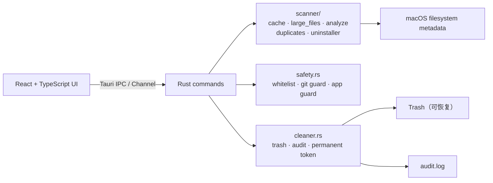

<p align="center">
  
</p>

<h1 align="center">SpaceSweeper</h1>

<p align="center">macOS 磁盘空间发现与安全回收工具</p>

<p align="center">
  <a href="#中文">中文</a> · <a href="#english">English</a>
</p>

> 先看清，再决定。  
> 一个独立的 macOS 文件发现与安全回收工具。

SpaceSweeper 是一个独立开发的原创 macOS 桌面工具，基于 **Tauri 2 + Rust + React/TypeScript**，核心目标：

1. 找到用户可能不再需要的文件；
2. 用透明、可逆的方式删除它们。
3. 用户需要能操作自己的电脑，删除合理的无用文件，拒绝收费捆绑提高门槛管理自己的电脑
4. 免费

它不做病毒查杀、恶意软件检测、性能优化、启动项管理，也不读取浏览器历史等隐私数据。

## 下载安装

当前版本：**v0.2.0**（Apple Silicon / arm64）

| 安装包 | 说明 | 大小 |
| --- | --- | --- |
| [DMG 安装包](https://github.com/ldyTomrrom/SpaceSweeper/raw/main/downloads/SpaceSweeper_0.2.0_aarch64.dmg) | 打开后把 SpaceSweeper 拖入 Applications | 4.6 MB |
| [PKG 安装包](https://github.com/ldyTomrrom/SpaceSweeper/raw/main/downloads/SpaceSweeper_0.2.0_installer.pkg) | 双击安装到 Applications | 3.8 MB |

- 系统要求：macOS 12+，当前预构建包仅支持 Apple Silicon（arm64）；Intel Mac 请从源码构建。
- 当前为 ad-hoc 签名，未做 Developer ID 公证。首次打开若被 macOS 拦截，请右键选择「打开」。
- 安装前请退出旧版本，并替换 Applications 中的 SpaceSweeper。
- 如果直链不可用，可进入 [`downloads/`](downloads/) 目录下载。
- 校验值：

<details>
<summary>SHA-256</summary>

```text
9df257c356c271286ce4257a4faf69cb247a3ba3bf7cfbd02e6b43958fda94b3  SpaceSweeper_0.2.0_aarch64.dmg
719de6a62a8c21e639199f0603336ad6be90e7e04069126bb70c768a909e7310  SpaceSweeper_0.2.0_installer.pkg
```

</details>

## 中文

### 项目定位

SpaceSweeper 的差异化不在“清理得多”，而在 **发现透明、删除可逆**：

- 每条结果都能展开查看完整路径、大小、修改时间与判定理由；
- 所有删除默认移入废纸篓，可在 Finder 中「放回原处」恢复；
- 不存在“一键静默清理全部结果”的入口；
- 需要用户确认的内容不会默认勾选。

### 当前功能

当前版本为 `0.2.0`，已完成 P0 闭环与 P1/P2/P3 功能：

| 模块 | 能力 |
| --- | --- |
| 智能扫描 | 扫描应用缓存、日志、开发者缓存与包管理器缓存；按分组流式推送结果 |
| 大文件 | 扫描 `~/Downloads`、`~/Desktop`、`~/Documents`、`~/Movies`，默认展示 ≥100 MB 的 Top 50 |
| 旧文件 | ≥100 MB 且 ≥365 天未修改，按“大小 × 陈旧天数”排序，Top 50 |
| 旧安装包 | `.dmg` / `.pkg` / `.zip`，≥50 MB 且 ≥180 天，Top 50 |
| 需确认区域 | 设备符号、Docker 数据、模拟器设备、模型缓存与 iOS 备份；默认不勾选，逐项确认 |
| 空间分析 | 目录大小树图、逐层下钻；文件可删除，目录仅定位 |
| 自定义目录 | 原生目录选择器；主目录子目录与外接卷可做会话级删除授权，重启失效 |
| 重复文件 | 大小分组 → 4 KB 哈希 → 完整 BLAKE3；每组至少保留一份，删除前后端复核 |
| 卸载器 | `/Applications`、`~/Applications` 应用发现；Bundle ID 残留匹配；个人数据残留默认不勾选 |
| 安全删除 | 默认移入废纸篓；永久删除必须显式勾选并输入确认词；删除前再次执行白名单与版本库校验 |
| 定位 | 在 Finder 中显示所选文件或目录 |
| 扫描控制 | 进度展示、取消扫描，取消后可查看已发现的部分结果 |
| 权限引导 | 未授予完全磁盘访问权限时展示引导，不静默失败 |

### 安全设计

删除安全是本项目的第一优先级，核心守卫位于 [`safety.rs`](src-tauri/src/safety.rs)：

- **白名单根目录**：只允许删除固定用户目录、缓存/日志白名单与会话级授权目录内的内容；
- **规范化路径**：先 `canonicalize` 再比较，防止父级符号链接逃逸；
- **拒绝危险路径**：`..`、符号链接、白名单根目录本身、`/System`、`/usr`、`/bin` 等系统路径全部拒绝；
- **版本库保护**：扫描阶段跳过包含 `.git` 的仓库根目录；删除阶段向上检查祖先目录，仓库内文件即使被前端传入也会被拒绝；
- **运行中应用保护**：直接以 Bundle ID 命名的缓存目录在对应 App 运行时跳过；
- **默认废纸篓**：`cleaner.rs` 在 macOS 上通过 `NSFileManager` 移入废纸篓；
- **永久删除 opt-in**：必须显式勾选并输入「永久删除」，后端使用 5 分钟有效、一次性、与路径清单绑定的令牌；
- **需确认区域**：默认不勾选，必须逐项选择并勾选风险确认；运行中的 Docker、Xcode、模拟器会被跳过；
- **会话级授权**：自定义目录/外接卷只允许主目录非 Library 子目录或 `/Volumes` 子目录，授权只存在当前进程，重启失效；
- **重复文件保留约束**：每组至少保留一份，删除前后端复核保留项存在、大小与完整哈希一致；
- **卸载器边界**：只允许 `/Applications` 或 `~/Applications` 下的 `.app`；以 Info.plist 的真实 Bundle ID 为准，系统应用不提供删除入口；残留必须来自固定 Library 子目录并匹配 Bundle ID/应用名；
- **审计日志**：删除结果逐项写入 `~/Library/Logs/SpaceSweeper/audit.log`；
- **无遥测、无自动清理、无后台常驻扫描**。

「需确认」档路径（Xcode DeviceSupport、CoreSimulator Devices、Docker 数据、Ollama/HuggingFace 模型缓存、iOS 备份）已通过智能扫描页的「需确认区域」开放。

### 架构



技术栈：

- Tauri 2、Rust、Rayon、WalkDir、Trash
- React 18、TypeScript、Vite
- Tauri Channel 流式扫描进度
- 原生 macOS 废纸篓 API、TCC/FDA 检测

### 项目结构

```text
.
├── src/                       # React 界面
│   ├── components/            # 侧边栏、结果列表、确认框、需确认面板、树图、图标
│   ├── pages/                 # 智能扫描、空间分析、大文件、重复文件、卸载器
│   ├── hooks/                 # 空间分析、重复文件、应用扫描 hook
│   ├── lib/                   # 格式化与树图布局
│   ├── types.ts               # 前后端共享类型
│   └── App.tsx                # App Shell 与页面切换
├── src-tauri/
│   ├── src/
│   │   ├── safety.rs          # 路径白名单、版本库、应用包与残留守卫
│   │   ├── cleaner.rs         # 废纸篓、审计日志、永久删除令牌
│   │   ├── scan_manager.rs    # 扫描任务注册与取消
│   │   ├── permissions.rs     # 完全磁盘访问权限检测
│   │   ├── fs_util.rs         # 磁盘占用计算
│   │   ├── scanner/
│   │   │   ├── cache.rs       # 缓存/日志/开发者/包管理器缓存
│   │   │   ├── large_files.rs # 大文件/旧文件/旧安装包
│   │   │   ├── analyze.rs     # 空间分析树
│   │   │   ├── duplicates.rs  # 重复文件检测与删除复核
│   │   │   ├── uninstaller.rs # 应用发现、残留匹配与卸载
│   │   │   └── rules.rs       # 共享扫描过滤规则
│   │   └── main.rs            # Tauri 命令入口
│   ├── capabilities/          # Tauri 权限能力
│   ├── icons/                 # 应用图标
│   ├── Cargo.toml
│   └── tauri.conf.json
├── PROJECT_BACKLOG.md         # 本次长任务节点与验收标准
├── package.json
└── vite.config.ts
```

### 快速开始

环境要求：

- macOS 12+
- Node.js 20+
- Rust stable
- Xcode Command Line Tools（本项目已在仅安装 CLT 的环境完成构建和打包）

```bash
# 安装前端依赖
npm install

# 开发模式
npm run tauri dev

# 前端类型检查与构建
npm run build

# Rust 单元测试
cd src-tauri && cargo test

# 构建 macOS App 与 DMG
npm run tauri build
```

构建产物：

```text
src-tauri/target/release/bundle/macos/SpaceSweeper.app
src-tauri/target/release/bundle/dmg/SpaceSweeper_0.2.0_aarch64.dmg
```

如果所在网络访问 crates.io 较慢，可以自行配置 Cargo 镜像。项目中的 `src-tauri/.cargo/` 已被 `.gitignore` 忽略，不会把个人镜像配置提交到仓库。

### 使用方式

1. 打开 SpaceSweeper；
2. 在侧边栏选择智能扫描、空间分析、大文件、重复文件或卸载器；
3. 查看完整路径、大小和判定理由，取消勾选不想删除的条目；
4. 点击「移入废纸篓」并确认；需要不可恢复删除时，在确认框中显式勾选并输入「永久删除」；
5. 在废纸篓中确认无误后清空，空间才会真正释放。

自定义目录或外接卷只在当前会话内授权删除；关闭并重新打开应用后需要重新选择。

完全磁盘访问权限不是默认用户目录扫描的必需项；授予后可以扫描更多受 TCC 保护的目录。授权后建议重启 App。

### 已知限制

- 当前预构建产物为 Apple Silicon `arm64`，源码可在 Intel Mac 上重新构建；
- 大文件/旧文件默认只展示 Top 50；重复文件最多展示 200 组，每组展示前 50 个；
- 空间分析默认展开 4 层、每层 18 个子项；更深的目录需要单独重新分析；
- 旧文件年龄基于修改时间；macOS APFS 的访问时间不可靠，因此不依赖 atime；
- 卸载器只处理 `.app` 应用包，不处理 PKG 安装脚本、系统扩展、守护进程与系统应用；
- 会话级授权目录在重启应用后失效；
- 当前构建为 ad-hoc 签名，未做 Developer ID 公证；分发给其他用户前需要正式签名和公证。

### Roadmap

- **发布**：Developer ID 签名、公证、通用二进制构建；
- **体验**：空间分析树图缩放、重复文件按目录筛选、卸载器残留规则扩充；
- **工程**：GitHub Actions 持续集成（`cargo test`、`cargo fmt --check`、`npm run build`）。

### 参与贡献

请阅读 [CONTRIBUTING.md](CONTRIBUTING.md)。所有涉及删除、路径校验、权限处理的改动都必须补充测试，并遵守现有的安全不变量。

### 安全

请阅读 [SECURITY.md](SECURITY.md)。不要在公开 Issue 中披露可被利用的路径逃逸、越权删除或权限绕过问题。

### 许可证

[Apache License 2.0](LICENSE) © 2026 Dingyuan Liu

### 免责声明

本工具会移动文件到废纸篓。尽管内置了多层安全守卫，仍建议先在测试目录验证，再处理真实数据。作者不对使用本工具造成的数据丢失承担责任。

---

## English

SpaceSweeper is a macOS disk space discovery and safe reclamation tool built with **Tauri 2, Rust and React**. It focuses on transparency and reversibility rather than aggressive one-click cleaning:

- Every result exposes its full path, size and rationale.
- Deletions go to the macOS Trash by default and can be restored with “Put Back”.
- Git worktrees, symlinks, system paths and the scan roots themselves are rejected by the backend.
- No malware scanning, performance tuning, startup-item management, telemetry or background scanning.

The current release supports grouped cache/log/developer/package-manager scanning, large/old file discovery, a space treemap with session-scoped custom directory authorization, three-stage duplicate detection with a guaranteed retained copy, and an uninstaller with Bundle ID residual matching. Permanent deletion is opt-in and requires typed confirmation.

Prebuilt Apple Silicon installers are available in the download section above and in [`downloads/`](downloads/). They are ad-hoc signed and not notarized.

Licensed under the [Apache License 2.0](LICENSE).
